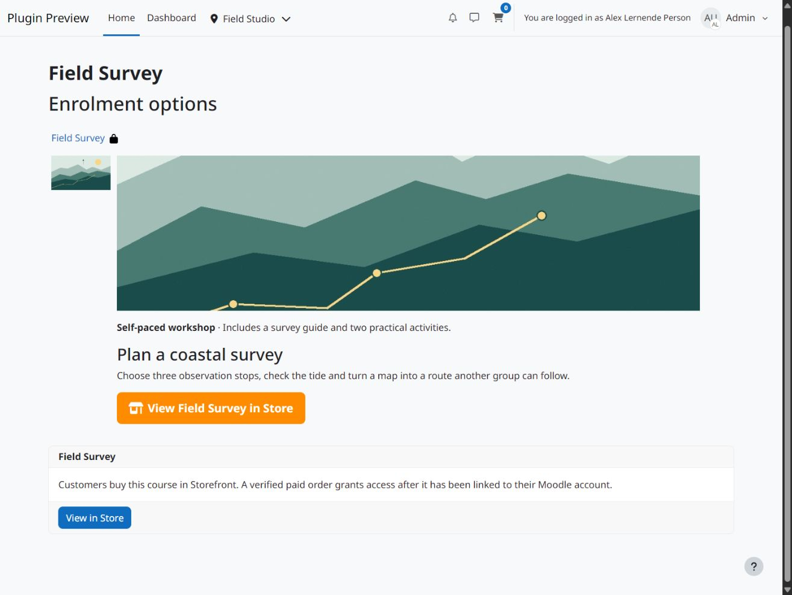
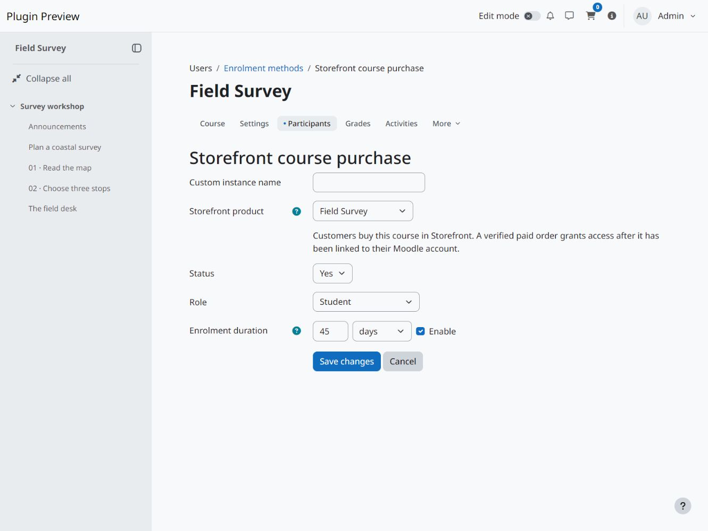

  

# Storefront Enrolment

Link 108design Storefront products to Moodle courses. Storefront handles offers,
checkout and payment verification. Storefront Enrolment grants access to the
linked courses once Storefront confirms payment and identifies the buyer's Moodle
account.

See [Storefront LE](https://github.com/108design/moodle-local_storefront-le) for
downloads and setup instructions.

## Screenshots

View screenshots

## Set up course access

1. Install a compatible 108design Storefront release on Moodle 4.5 or later.
   Configure a payment method and publish the product you want to sell.
2. Install Storefront Enrolment and enable it under **Manage enrol plugins** in
   Site administration.
3. In each course, open **Enrolment methods** and add **Storefront Enrolment**.
   Select the product, the role to assign and the access duration.

Use the same product in multiple courses to sell them together. For a one-time
purchase, the access period starts when the plugin enrols the buyer. Leave the
duration unset for open-ended access. Subscription access follows the confirmed
billing period when the payment method supports subscriptions.

A course backup retains the product identifier as a disabled mapping hint.
After restoring a course, select the product and enable the mapping when you are
ready to sell access again. Purchased enrolments stay with the original course.

## License

Storefront Enrolment is distributed under the 108design source-available
commercial software license. See [LICENSE.md](LICENSE.md) for the terms.
